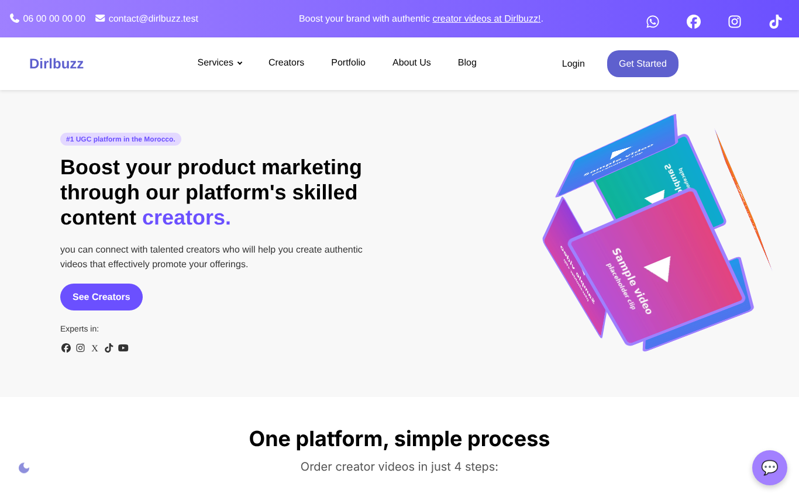
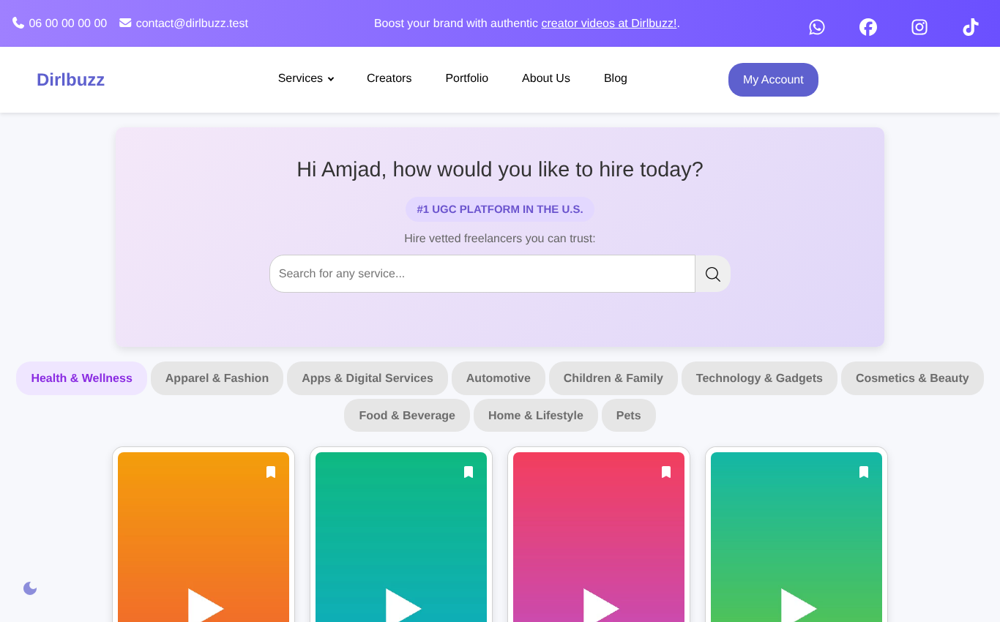
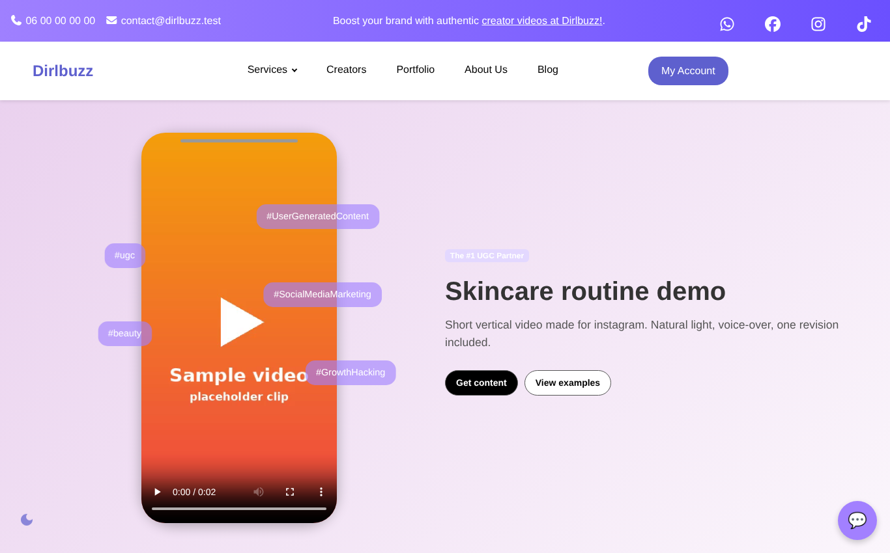
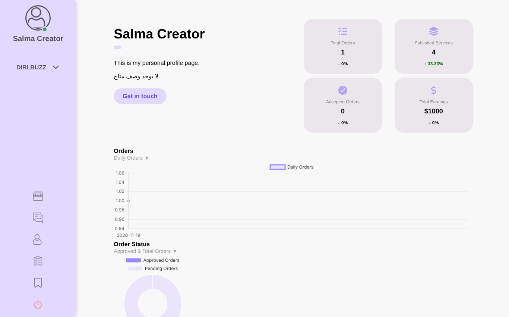
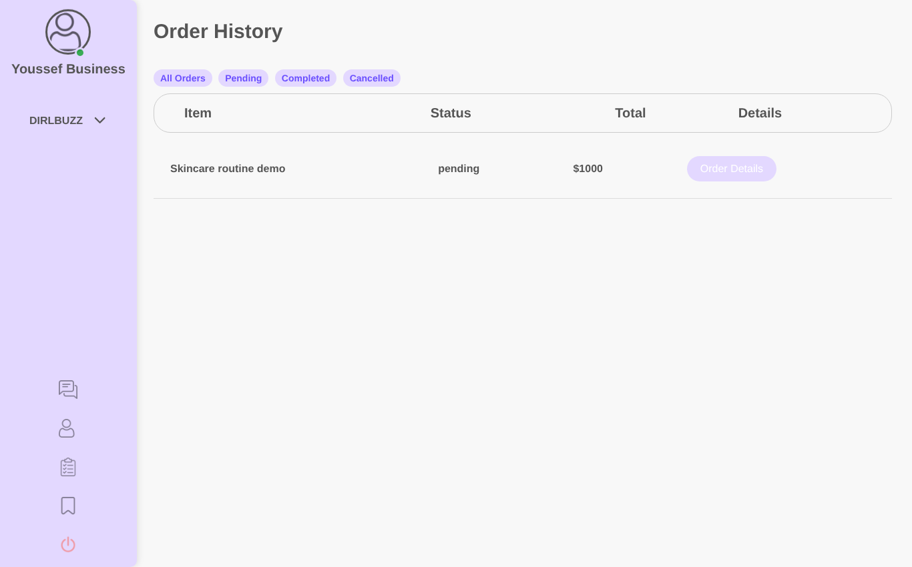
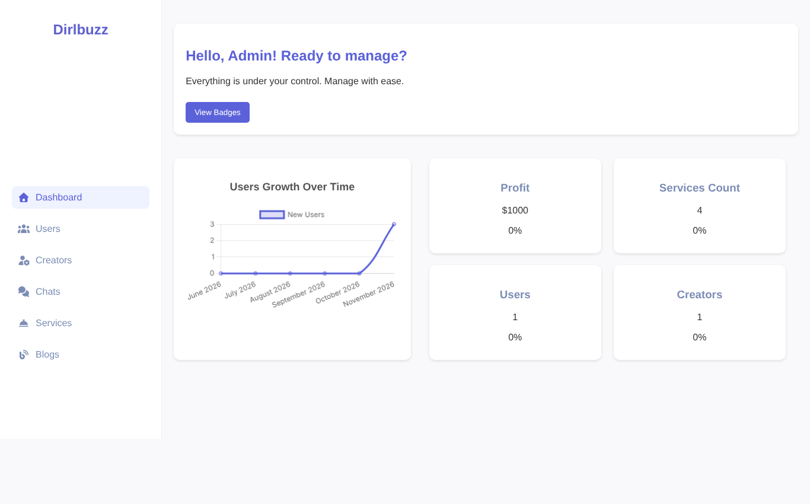
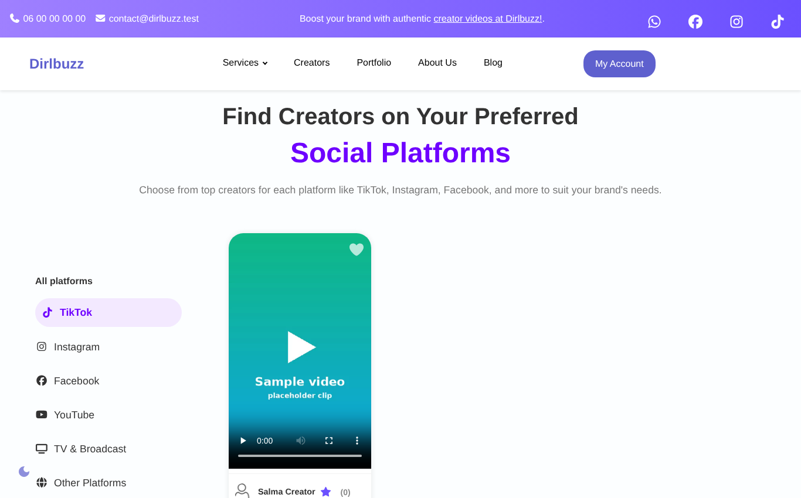

# Dirlbuzz

A marketplace where Moroccan businesses order short promotional videos (UGC) from content creators. A creator publishes a video service with a price per platform, a business browses, orders and chats with the creator, and a support team approves services before they go public.

The name comes from Moroccan Arabic: *dir l'buzz*, "make the buzz".



> This is a project I am still building. The code is public for review, but it is not open source. See [LICENSE](LICENSE).

## What works today

**Accounts**
- Sign up and log in as a creator or a business (token auth with Laravel Sanctum)
- Profile page with social links, description and profile image
- Password reset by email, and Google, Facebook and Instagram login through Socialite (both need your own keys in `.env`)

**Creators**
- Create a service: title, category, hashtags, a video upload, and a price per platform (Facebook, Instagram, TikTok, YouTube) and video type
- Edit and delete services
- Dashboard with order counts, earnings and charts
- Accept or cancel incoming orders

**Businesses**
- Browse published services by platform, by business type, or by creator
- Like a video and save it to a wishlist
- Order a service and follow the order status
- Message the creator from the service page

**Support team**
- Review new services and publish or reject them
- Lists of creators and business users
- Support chat with any user
- Blog posts

**Interface**
- Dark mode, responsive pages

## What is not finished

- No online payment yet. PayPal is mentioned in the interface but not integrated.
- Chat is not real time. The pages poll the API on a timer.
- `routes/api.php` grew over time and still has duplicate and unused routes that need a cleanup.
- A few pages throw a script error on load (personal info, edit service). The pages still work.
- The videos and portraits in this repo are generated placeholders. The real demo media is not included.

## Screenshots

| Browse creators | Service page |
|---|---|
|  |  |

| Creator dashboard | Business orders |
|---|---|
|  |  |

| Support dashboard | Browse by platform |
|---|---|
|  |  |

## Stack

| Part | Tech |
|---|---|
| Backend | Laravel 10, Sanctum, Socialite, Eloquent |
| Database | MySQL (SQLite also works) |
| Frontend | HTML, CSS and vanilla JavaScript, Bootstrap, Axios, Chart.js, Swiper |

## Project layout

```
backend/     Laravel REST API
frontend/    static pages, css/, js/, assets/
docs/        screenshots
```

The API address used by the pages is set in one place: `frontend/js/config.js`.

## Run it locally

You need PHP 8.1+, Composer and a database.

**Backend**

```bash
cd backend
composer install
cp .env.example .env
php artisan key:generate
```

Set your database in `.env` (or use `DB_CONNECTION=sqlite` and create `database/database.sqlite`), then:

```bash
php artisan migrate --seed
php artisan storage:link
php artisan serve
```

The API runs on http://localhost:8000

**Frontend**

Serve the `frontend` folder with any static server, for example:

```bash
cd frontend
python -m http.server 5500
```

Open http://localhost:5500

**Demo accounts** (created by the seeder, password `password`)

| Role | Email |
|---|---|
| Creator | creator@dirlbuzz.test |
| Business | business@dirlbuzz.test |
| Support | support@dirlbuzz.test |

**Tests**

```bash
cd backend
php artisan test
```

## Main API endpoints

| Method | Endpoint | Who | What it does |
|---|---|---|---|
| POST | /api/register | anyone | create a creator or business account |
| POST | /api/login | anyone | get a token |
| GET, POST | /api/profile | logged in | read and update the profile |
| POST | /api/services | creator | create a service with a video |
| GET | /api/my-services | creator | list my services |
| PUT | /api/services/update-status | support | publish or reject a service |
| GET | /api/services/update-status/published | anyone | list published services |
| GET | /api/services/{id} | anyone | service details |
| POST | /api/likes/toggle | logged in | like or unlike a service |
| GET, POST | /api/wishlist | logged in | saved videos |
| POST | /api/orders | business | order a service |
| GET | /api/orders | creator | orders received |
| GET | /api/ordersuser | business | orders sent |
| POST | /api/orders/{id}/status | creator | accept or cancel |
| GET | /api/stats, /api/chart-data | logged in | dashboard numbers |
| POST | /api/services/{id}/messages | logged in | message the creator of a service |
| GET | /api/chats | logged in | my conversations |
| POST | /api/support/message | logged in | write to support |

## Roadmap

- Online payment and creator payouts
- Real-time chat with WebSockets
- Clean up the routes and split the large controllers
- Move the frontend to a component framework
